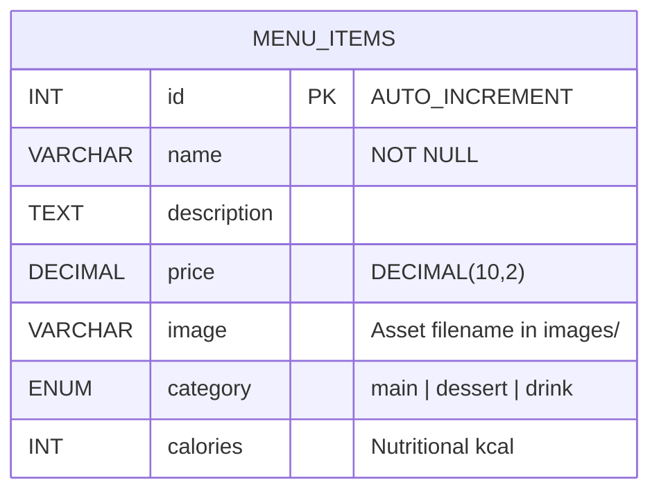

#  Restaurant-Menu-Website

**Abdulhamid Alaboud · Ahmed Alaglan**  
Department of Computer Science  
Jazan University, Saudi Arabia  

---

## Overview
A full-stack web application for a traditional restaurant featuring a dynamic menu, interactive shopping cart, calorie calculator, and checkout workflow. Built with PHP, MySQL, and modern front-end technologies using PDO prepared statements.

---

##  Key Features  
- **Dynamic Menu Display**: Categorized food items (Main Dishes, Desserts, Drinks) with images, descriptions, and prices fetched in real-time from MySQL database  
- **Interactive Shopping Cart**: Session-based cart management with add/remove functionality and real-time price calculation  
- **Health-conscious Calorie Calculator**: Automatic calorie computation for cart items with dietary recommendations  
- **Secure Order Processing**: Complete checkout flow with customer information validation, tax calculation, and order confirmation  
- **Responsive Design**: Mobile-friendly interface with consistent styling across all devices  
- **Admin-ready Structure**: Modular database design allowing easy menu updates and expansion  

---

##  Technical Architecture  

| Component | Technology | Purpose |
|-----------|------------|---------|
| **Frontend** | HTML5, CSS3, JavaScript | Responsive UI, client-side interactions, form validation |
| **Backend** | PHP 7.4+ | Server-side logic, session management, business logic |
| **Database** | MySQL 8.0 | Persistent data storage for menu items, categories, and orders |
| **Server** | Apache (XAMPP) | Local development and deployment environment |
| **Security** | PDO Prepared Statements | SQL injection prevention and secure database operations |

---

##  System Modules  

| Module | Core Functionality | Key Technologies |
|--------|-------------------|------------------|
| **Menu Display** | Dynamic loading of categorized food items from database | PHP, MySQL, CSS Grid |
| **Cart Management** | Session-based cart with real-time updates and calculations | PHP Sessions, JavaScript |
| **Calorie Analysis** | Nutritional calculation with health-based recommendations | PHP, MySQL Algorithms |
| **Order Processing** | Complete checkout with validation, tax, and confirmation | PHP, JavaScript, HTML Forms |

---

##  Repository Structure  

```
restaurant-menu/
├── index.html                 # Landing page with restaurant introduction
├── menu.php                   # Dynamic menu with category navigation
├── cart.php                   # Shopping cart management interface
├── CaloriesCalculator.php     # Nutritional analysis module
├── OrderConfirmation.php      # Checkout and order processing
├── db.php                     # Database connection (PDO)
├── styles.css                 # Unified styling across all pages
├── images/                    # Product images and logos
│   ├── logo.png
│   └── [menu-item-images].jpg
├── README.md                  # This documentation
└── LICENSE                    # MIT License file
```

---

## Database Schema (ERD)



A ready-to-import SQL schema with all 15 traditional menu items mapped to `images/` is provided in [`schema.sql`](schema.sql).

---

## Quick Setup & Installation

1. **Prerequisites**
   - Install [XAMPP](https://www.apachefriends.org/) (Apache + MySQL + PHP 7.4+).

2. **Import Database (`schema.sql`)**
   ```bash
   mysql -u root < schema.sql
   ```
   *(Or import [`schema.sql`](schema.sql) directly in phpMyAdmin.)*

3. **Deploy Locally**
   ```bash
   git clone https://github.com/Abdulhamid-Alaboud/Restaurant-Menu-Website.git
   cp -r Restaurant-Menu-Website C:\xampp\htdocs\restaurant-menu
   ```
   Update credentials in `db.php` if your MySQL instance uses a non-empty root password.

4. **Launch Application**
   - Start **Apache** and **MySQL** in XAMPP Control Panel.
   - Open `http://localhost/restaurant-menu/`.

---

##  Development Dependencies  

- **PHP**: 7.4 or higher (for PDO support and modern features)  
- **MySQL**: 8.0 or compatible (for JSON support and performance)  
- **Web Server**: Apache 2.4+ with mod_rewrite enabled  
- **Browser**: Modern Chrome, Firefox, or Edge with JavaScript enabled  
- **Code Editor**: VS Code, PHPStorm, or any IDE with PHP support  

---

##  Performance & Results  

- **Database Queries**: Optimized with prepared statements and proper indexing  
- **Page Load Time**: < 2 seconds for all dynamic pages on local server  
- **Cart Operations**: Real-time updates without page reload using PHP sessions  
- **Form Validation**: Client-side (JavaScript) and server-side (PHP) validation  
- **Security Measures**: SQL injection protection via PDO, session management  

---

##  Methodology  

1. **Requirements Analysis**: Identified core restaurant operations and user workflows  
2. **Database Design**: Created normalized schema for menu, categories, and orders  
3. **Frontend Development**: Built responsive interfaces with mobile-first approach  
4. **Backend Integration**: Connected PHP logic with MySQL using PDO for security  
5. **Feature Implementation**: Added cart, calculator, and checkout modules  
6. **Testing & Validation**: Tested all user flows and edge cases  

---

##  License  
This project is licensed under the MIT License - see the [LICENSE](LICENSE) file for details.

---

## Contact
For technical questions, collaboration opportunities, or feedback:
- **Repository Issues:** [GitHub Issues](https://github.com/Abdulhamid-Alaboud/Restaurant-Menu-Website/issues)
